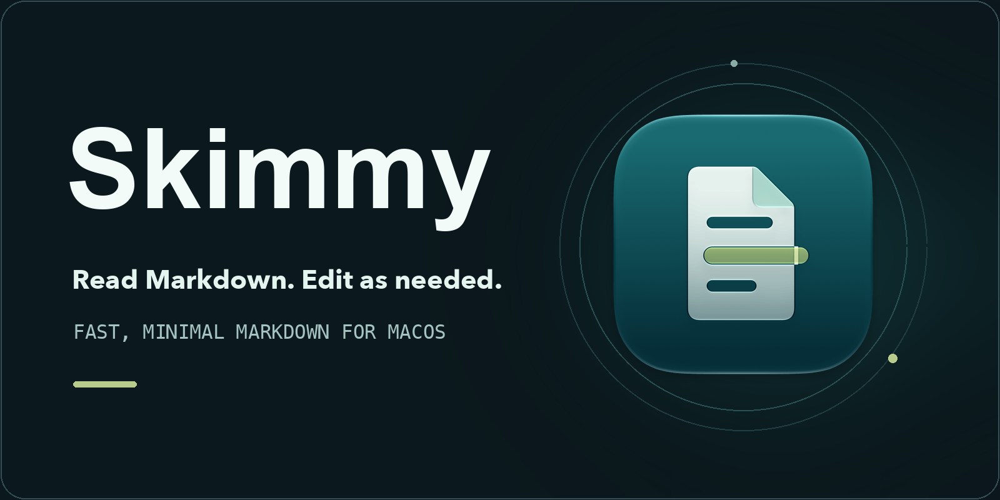

<p align="center">
  
</p>

<p align="center">
  <a href="https://github.com/giulioc84/skimmy_markdown/releases/latest"></a>
  
  
  <a href="LICENSE"></a>
</p>

# Skimmy

Skimmy is a native Markdown editor and viewer for macOS. Open a README, a set
of notes, or a long draft and jump straight to the section you need. Edit right
on the formatted page or switch to Markdown source whenever you need it.

<p align="center">
  <a href="https://github.com/giulioc84/skimmy_markdown/releases/latest"><b>Download for Mac</b></a>
  &nbsp;·&nbsp; <a href="#build-from-source">Build from source</a>
  &nbsp;·&nbsp; <a href="https://giuliocolla.com/code/skimmy/">Website</a>
  &nbsp;·&nbsp; <a href="CHANGELOG.md">Changelog</a>
  &nbsp;·&nbsp; <a href="https://github.com/giulioc84/skimmy_markdown/issues">Report a bug</a>
</p>

<table align="center">
  <tr>
    <td align="center" width="50%"><a href="docs/screenshot-sidebar.png"></a></td>
    <td align="center" width="50%"><a href="docs/screenshot-editor.png"></a></td>
  </tr>
  <tr>
    <td align="center"><sub>Read with the outline open</sub></td>
    <td align="center"><sub>Work in Markdown source</sub></td>
  </tr>
</table>

<p align="center"><sub>Screenshots from Skimmy 1.0.0</sub></p>

## Highlights

- **Edit the formatted page.** Change headings, emphasis, inline code, lists,
  and links from the Format menu. Check off tasks directly in the document.
- **Read GitHub-flavored Markdown.** Tables, code blocks, and task lists render
  in Read mode. Use Source for precise control over Markdown syntax.
- **Find your place.** Jump to a heading or browse links from the sidebar. In
  Edit, replace the current search match or all matches at once.
- **Open and save ordinary Markdown files.** Skimmy supports `.md`,
  `.markdown`, and `.mdown` with standard macOS document commands.
- **Make the page easier to read.** Choose System, Light, or Dark in Settings
  and adjust the text size. Open the offline guide from **Help › Skimmy Help**.

## Getting started

1. On a Mac with Apple silicon and macOS 26 or later, download
   [Skimmy.zip](https://github.com/giulioc84/skimmy_markdown/releases/latest/download/Skimmy.zip).
2. Unzip it and drag **Skimmy.app** into **Applications**.
3. Open Skimmy and press **⌘O** to open a Markdown file.

The download is signed with Apple Developer ID and notarized by Apple.

<details>
<summary>Keyboard shortcuts</summary>

| Shortcut | Action |
| --- | --- |
| `⌘E` | Switch between Read and Edit |
| `⇧⌘L` | Show or hide the sidebar |
| `⌘S` | Save |
| `⌘F` | Find |
| `⌘G` / `⇧⌘G` | Find the next or previous match |
| `⌘=` / `⌘-` / `⌘0` | Increase, decrease, or reset the text size |
| `⌘,` | Open Settings |

</details>

## Good to know

Skimmy keeps the original Markdown for blocks you leave untouched. Edited
blocks can use different syntax for the same formatting. Choose **Source**
when the exact syntax matters.

Links to headings in the same document are supported. Links between Markdown
files are [planned](docs/relative-markdown-links.md).

## Build from source

Use Xcode 26 or later and [XcodeGen](https://github.com/yonaskolb/XcodeGen).

```sh
brew install xcodegen
git clone https://github.com/giulioc84/skimmy_markdown.git
cd skimmy_markdown
make build
```

The built app is at `.build/Build/Products/Release/Skimmy.app`. Skimmy uses
SwiftUI for the window and controls, AppKit for source editing, and WebKit
with bundled Markdown libraries for the formatted page.

<details>
<summary>Maintainer commands</summary>

- `make generate` creates the Xcode project.
- `make install` builds, copies Skimmy to Applications, and signs it with an
  identity from your keychain. Set `SIGN_IDENTITY` to override the choice.
- `make release` builds the distribution with a Developer ID Application
  certificate and an Apple notarization profile, then writes `dist/Skimmy.zip`.
  Optionally pass `VERSION=x.y.z` to update `project.yml` first.

Set up the notarization profile once with
`xcrun notarytool store-credentials SKIMMY_NOTARY`. Set `NOTARY_PROFILE` if
your profile has a different name.

</details>

## Support and license

Use [GitHub Discussions](https://github.com/giulioc84/skimmy_markdown/discussions)
for questions or see the [reporting guide](CONTRIBUTING.md) for bugs. You can
also [support Skimmy on GitHub Sponsors](https://github.com/sponsors/giulioc84).

Skimmy is source-available under a [proprietary license](LICENSE). Bundled
libraries keep their [own licenses](THIRD_PARTY_NOTICES.md).
